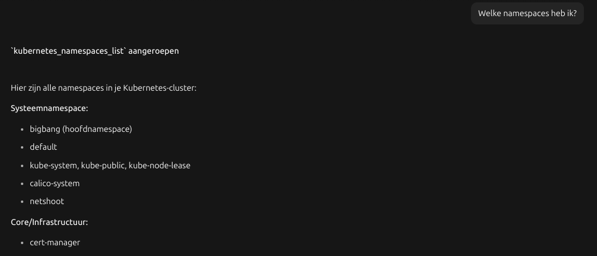

# AI Kubernetes SRE

The idea is to use a LLM to inspect the Kubernetes infrastructure; find mistakes and provide advise for fixes.

## Load the model

```
export OLLAMA_HOST="https://ollama.dev.bigbang.mil"
ollama pull qwen3.5:9b
```

## Ask a question

The qwen-ollama agent is setup to use qwen3.5:9b on Ollama using the GPU.

Access the agent on [qwen-ollama agent](https://qwen-ollama.agent.opencode.dev.scipio.mil/)

Then ask a question like following:


