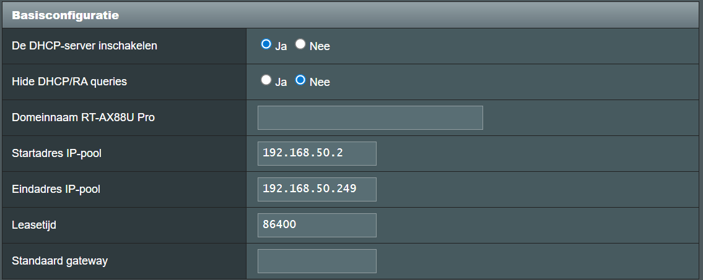
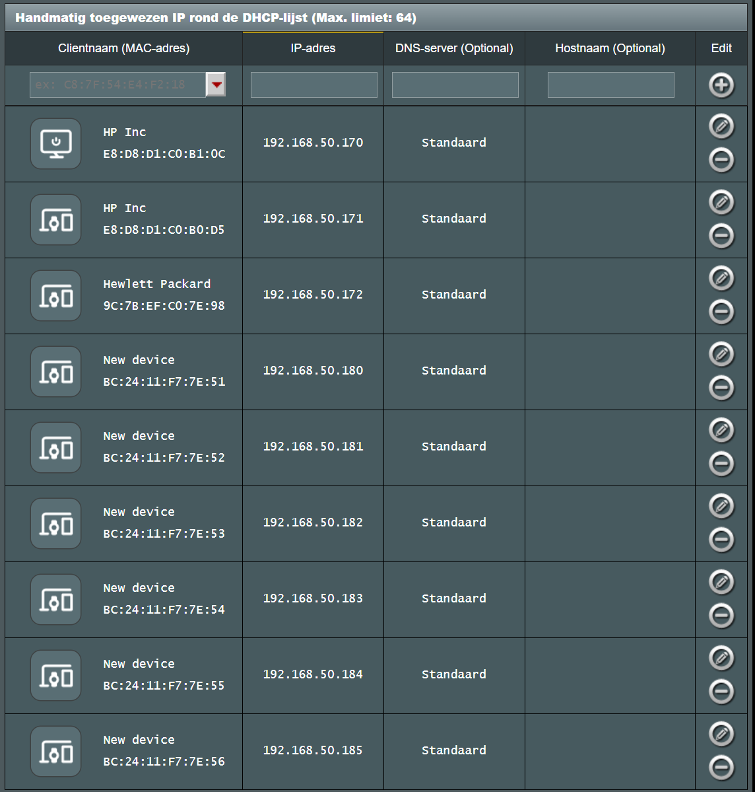
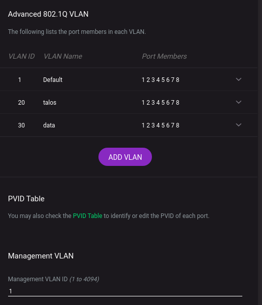

# Talos

Following is an (ad-hoc) manual to run bigbang on a Proxmox / Talos homelab. In this specific setup an Asus RT-AX88U-Pro router is used running Merlin firmware and a Netgear GS108E managed switch is used.

## Network design

| VLAN | Naam | Subnet | Gebruik |
| -----| ---- | ---- | ---- |
| -  | MGMT	| 192.168.10.0/24	| Proxmox, switches, AP's, Talos API
| 20 | K8S | 192.168.20.0/24 | Talos/Kubernetes nodes & clusterverkeer
| 30 | SERVICES | 192.168.30.0/24 | VM's, containers, interne services
| 40 | DMZ | 192.168.40.0/24 | Eventueel publiek bereikbare services

                        INTERNET
                            │
                       RT-AX88U Pro
                       /          \
                      /            \
                   TRUNK            \
             VLAN 1/20/30/40      AiMesh
                   |               AX53U
                 GS108E             
               /   |   \             
              /    |    \              
           PVE1   PVE2   PVE3          
            │
            │          
     ┌──────┴──────┐   
     │    vmbr0    │   
     │ VLAN aware  │   
     └──────┬──────┘   
            │
     ┌──────┼───────────┐
     │      │           │
   VLAN1  VLAN20      VLAN30
    MGMT   K8S       SERVICES
     │      │           │
     │      │           ├─ Grafana
     │      │           ├─ Traefik
     │      │           └─ ...
     │      │
     │      ├─ Talos-01
     │      ├─ Talos-02
     │      └─ Talos-03
     │
     ├─ Proxmox-01
     ├─ Proxmox-02
     └─ Proxmox-03

## Hardware setup

### Proxmox hosts
```
p1: 192.168.50.170|i5(6vcpu)|256(nvme)|512(ssd)|32GB
    ctl1: 192.168.20.10|BC:24:11:F7:7E:11|6vcpu|32GB(nvme)|8GB
    wrk1: 192.168.20.20|BC:24:11:F7:7E:12|6vcpu|32GB(nvme)|240(ssd)|12GB(12288)
    wrk2: 192.168.20.21|BC:24:11:F7:7E:13|6vcpu|32GB(nvme)|240(ssd)|12GB(12288)

p2: 192.168.50.171|i5(6vcpu)|256(nvme)|512(ssd)|40GB
    ctl2: 192.168.20.11|BC:24:11:F7:7E:21|6vcpu|32GB(nvme)|8GB
    wrk3: 192.168.20.22|BC:24:11:F7:7E:22|6vcpu|32GB(nvme)|240(ssd)|16GB(16384)
    wrk4: 192.168.20.23|BC:24:11:F7:7E:23|6vcpu|32GB(nvme)|240(ssd)|16GB

p3: 192.168.50.172|i5(6vcpu)|256(nvme)|512(ssd)|40GB
    ctl3: 192.168.20.12|BC:24:11:F7:7E:31|6vcpu|32GB(nvme)|8GB
    wrk5: 192.168.20.24|BC:24:11:F7:7E:32|6vcpu|32GB(nvme)|240(ssd)|16GB
    wrk6: 192.168.20.25|BC:24:11:F7:7E:33|6vcpu|32GB(nvme)|240(ssd)|16GB

p4: 192.168.50.173|xeon2125(8vcpu)|256nvme|250(ssd)|64GB
    ai1: 192.168.20.26|BC:24:11:F7:7E:41|1gpu|6vcpu|32GB(nvme)|230(ssd)|56GB
```

## Router setup

### jffs

See [scipts](./rt-ax88u-pro/jffs/) for vlan setup (bridge, gw, dhcp, firewall)

### DHCP

Fixed mac-address -> ip-address mappings for proxmox hosts.

Enable DHCP (excluding a cidr for load-balancing)


Assign fixed addresses to the hosts and vm's


## Switch GS108E setup

Configure the switch to support VLAN's 20 and 30 as trunk on all ports.



## Proxmox

### VLAN aware bridge

Example /etc/network/interfaces (but default support for 2-4094 is fine as well):
```
auto lo
iface lo inet loopback

iface eno1 inet manual

auto vmbr0
iface vmbr0 inet manual
        bridge-ports eno1
        bridge-stp off
        bridge-fd 0
        bridge-vlan-aware yes
        bridge-vids 10 20 30 40
```

### Create VM's

Shell into the proxmox node (one-by-one) using the gui and create the vm's using a preloaded [image from talos](https://factory.talos.dev/).

Select following extentions:
1. qemu-guest-agent
2. nonfree-kmod-nvidia-lts  (for P2000 or RTX-A4000)
3. nvidia-container-toolkit-lts

### Host P1
```
export BRIDGE=vmbr0
export VM_CTL1_NAME=bb9-ctl1
export VM_WRK1_NAME=bb9-wrk1
export VM_WRK2_NAME=bb9-wrk2
export VM_CTL1_ID=201
export VM_WRK1_ID=202
export VM_WRK2_ID=203

qm stop ${VM_CTL1_ID}
qm destroy ${VM_CTL1_ID}
qm stop ${VM_WRK1_ID}
qm destroy ${VM_WRK1_ID}
qm stop ${VM_WRK2_ID}
qm destroy ${VM_WRK2_ID}

pvesm alloc local-lvm $VM_CTL1_ID vm-${VM_CTL1_ID}-disk-0 32G
pvesm alloc local-lvm $VM_WRK1_ID vm-${VM_WRK1_ID}-disk-0 32G
pvesm alloc local-lvm $VM_WRK2_ID vm-${VM_WRK2_ID}-disk-0 32G
pvesm alloc data $VM_WRK1_ID vm-${VM_WRK1_ID}-disk-1 240G
pvesm alloc data $VM_WRK2_ID vm-${VM_WRK2_ID}-disk-1 240G

qm create ${VM_CTL1_ID} \
  --agent 1 \
  --ide2 local:iso/metal-amd64-qemu.iso,media=cdrom,size=308556K \
  --name ${VM_CTL1_NAME} \
  --net0 virtio=BC:24:11:F7:7E:11,bridge=${BRIDGE},firewall=1,trunks="20;30" \
  --scsi0 local-lvm:vm-${VM_CTL1_ID}-disk-0,size=32G \
  --scsihw virtio-scsi-pci \
  --ostype l26 \
  --machine q35 \
  --memory 8192 \
  --onboot no \
  --sockets 1 \
  --cpu x86-64-v3 \
  --cores 6 \
  --boot "order=scsi0;ide2;net0" \
  --numa 0

qm create ${VM_WRK1_ID} \
  --agent 1 \
  --ide2 local:iso/metal-amd64-qemu.iso,media=cdrom,size=308556K \
  --name ${VM_WRK1_NAME} \
  --net0 virtio=BC:24:11:F7:7E:12,bridge=${BRIDGE},firewall=1,trunks="20;30" \
  --scsi0 local-lvm:vm-${VM_WRK1_ID}-disk-0,size=32G \
  --scsi1 data:vm-${VM_WRK1_ID}-disk-1,discard=on,size=240G \
  --scsihw virtio-scsi-pci \
  --ostype l26 \
  --machine q35 \
  --memory 12288 \
  --onboot no \
  --sockets 1 \
  --cpu x86-64-v3 \
  --cores 6 \
  --boot "order=scsi0;ide2;net0" \
  --numa 0

qm create ${VM_WRK2_ID} \
  --agent 1 \
  --ide2 local:iso/metal-amd64-qemu.iso,media=cdrom,size=308556K \
  --name ${VM_WRK2_NAME} \
  --net0 virtio=BC:24:11:F7:7E:13,bridge=${BRIDGE},firewall=1,trunks="20;30" \
  --scsi0 local-lvm:vm-${VM_WRK2_ID}-disk-0,size=32G \
  --scsi1 data:vm-${VM_WRK2_ID}-disk-1,discard=on,size=240G \
  --scsihw virtio-scsi-pci \
  --ostype l26 \
  --machine q35 \
  --memory 12288 \
  --onboot no \
  --sockets 1 \
  --cpu x86-64-v3 \
  --cores 6 \
  --boot "order=scsi0;ide2;net0" \
  --numa 0

qm start ${VM_CTL1_ID}
qm start ${VM_WRK1_ID}
qm start ${VM_WRK2_ID}

qm agent ${VM_CTL1_ID} network-get-interfaces
qm agent ${VM_WRK1_ID} network-get-interfaces
qm agent ${VM_WRK2_ID} network-get-interfaces
```

### Host P2
```
export BRIDGE=vmbr0
export VM_CTL2_NAME=bb9-ctl2
export VM_WRK3_NAME=bb9-wrk3
export VM_WRK4_NAME=bb9-wrk4
export VM_CTL2_ID=204
export VM_WRK3_ID=205
export VM_WRK4_ID=206

qm stop ${VM_CTL2_ID}
qm destroy ${VM_CTL2_ID}
qm stop ${VM_WRK3_ID}
qm destroy ${VM_WRK3_ID}
qm stop ${VM_WRK4_ID}
qm destroy ${VM_WRK4_ID}

pvesm alloc local-lvm $VM_CTL2_ID vm-${VM_CTL2_ID}-disk-0 32G
pvesm alloc local-lvm $VM_WRK3_ID vm-${VM_WRK3_ID}-disk-0 32G
pvesm alloc local-lvm $VM_WRK4_ID vm-${VM_WRK4_ID}-disk-0 32G
pvesm alloc data $VM_WRK3_ID vm-${VM_WRK3_ID}-disk-1 240G
pvesm alloc data $VM_WRK4_ID vm-${VM_WRK4_ID}-disk-1 240G

qm create ${VM_CTL2_ID} \
  --agent 1 \
  --ide2 local:iso/metal-amd64-qemu.iso,media=cdrom,size=308556K \
  --name ${VM_CTL2_NAME} \
  --net0 virtio=BC:24:11:F7:7E:21,bridge=${BRIDGE},firewall=1,trunks="20;30" \
  --scsi0 local-lvm:vm-${VM_CTL2_ID}-disk-0,size=32G \
  --scsihw virtio-scsi-pci \
  --ostype l26 \
  --machine q35 \
  --memory 8192 \
  --onboot no \
  --sockets 1 \
  --cpu x86-64-v3 \
  --cores 6 \
  --boot "order=scsi0;ide2;net0" \
  --numa 0

qm create ${VM_WRK3_ID} \
  --agent 1 \
  --ide2 local:iso/metal-amd64-qemu.iso,media=cdrom,size=308556K \
  --name ${VM_WRK3_NAME} \
  --net0 virtio=BC:24:11:F7:7E:22,bridge=${BRIDGE},firewall=1,trunks="20;30" \
  --scsi0 local-lvm:vm-${VM_WRK3_ID}-disk-0,size=32G \
  --scsi1 data:vm-${VM_WRK3_ID}-disk-1,discard=on,size=240G \
  --scsihw virtio-scsi-pci \
  --ostype l26 \
  --machine q35 \
  --memory 14336 \
  --onboot no \
  --sockets 1 \
  --cpu x86-64-v3 \
  --cores 6 \
  --boot "order=scsi0;ide2;net0" \
  --numa 0

qm create ${VM_WRK4_ID} \
  --agent 1 \
  --ide2 local:iso/metal-amd64-qemu.iso,media=cdrom,size=308556K \
  --name ${VM_WRK4_NAME} \
  --net0 virtio=BC:24:11:F7:7E:23,bridge=${BRIDGE},firewall=1,trunks="20;30" \
  --scsi0 local-lvm:vm-${VM_WRK4_ID}-disk-0,size=32G \
  --scsi1 data:vm-${VM_WRK4_ID}-disk-1,discard=on,size=240G \
  --scsihw virtio-scsi-pci \
  --ostype l26 \
  --machine q35 \
  --memory 14336 \
  --onboot no \
  --sockets 1 \
  --cpu x86-64-v3 \
  --cores 6 \
  --boot "order=scsi0;ide2;net0" \
  --numa 0

qm start ${VM_CTL2_ID}
qm start ${VM_WRK3_ID}
qm start ${VM_WRK4_ID}

qm agent ${VM_CTL2_ID} network-get-interfaces
qm agent ${VM_WRK3_ID} network-get-interfaces
qm agent ${VM_WRK4_ID} network-get-interfaces
```

### Host P3
```
export BRIDGE=vmbr0
export VM_CTL3_NAME=bb9-ctl3
export VM_WRK5_NAME=bb9-wrk5
export VM_WRK6_NAME=bb9-wrk6
export VM_CTL3_ID=207
export VM_WRK5_ID=208
export VM_WRK6_ID=209

qm stop ${VM_CTL3_ID}
qm destroy ${VM_CTL3_ID}
qm stop ${VM_WRK5_ID}
qm destroy ${VM_WRK5_ID}
qm stop ${VM_WRK6_ID}
qm destroy ${VM_WRK6_ID}

pvesm alloc local-lvm $VM_CTL3_ID vm-${VM_CTL3_ID}-disk-0 32G
pvesm alloc local-lvm $VM_WRK5_ID vm-${VM_WRK5_ID}-disk-0 32G
pvesm alloc local-lvm $VM_WRK6_ID vm-${VM_WRK6_ID}-disk-0 32G
pvesm alloc data $VM_WRK5_ID vm-${VM_WRK5_ID}-disk-1 240G
pvesm alloc data $VM_WRK6_ID vm-${VM_WRK6_ID}-disk-1 240G

qm create ${VM_CTL3_ID} \
  --agent 1 \
  --ide2 local:iso/metal-amd64-qemu.iso,media=cdrom,size=308556K \
  --name ${VM_CTL3_NAME} \
  --net0 virtio=BC:24:11:F7:7E:31,bridge=${BRIDGE},firewall=1,trunks="20;30" \
  --scsi0 local-lvm:vm-${VM_CTL3_ID}-disk-0,size=32G \
  --scsihw virtio-scsi-pci \
  --ostype l26 \
  --machine q35 \
  --memory 8192 \
  --onboot no \
  --sockets 1 \
  --cpu x86-64-v3 \
  --cores 6 \
  --boot "order=scsi0;ide2;net0" \
  --numa 0

qm create ${VM_WRK5_ID} \
  --agent 1 \
  --ide2 local:iso/metal-amd64-qemu.iso,media=cdrom,size=308556K \
  --name ${VM_WRK5_NAME} \
  --net0 virtio=BC:24:11:F7:7E:32,bridge=${BRIDGE},firewall=1,trunks="20;30" \
  --scsi0 local-lvm:vm-${VM_WRK5_ID}-disk-0,size=32G \
  --scsi1 data:vm-${VM_WRK5_ID}-disk-1,discard=on,size=240G \
  --scsihw virtio-scsi-pci \
  --ostype l26 \
  --machine q35 \
  --memory 16384 \
  --onboot no \
  --sockets 1 \
  --cpu x86-64-v3 \
  --cores 6 \
  --boot "order=scsi0;ide2;net0" \
  --numa 0

qm create ${VM_WRK6_ID} \
  --agent 1 \
  --ide2 local:iso/metal-amd64-qemu.iso,media=cdrom,size=308556K \
  --name ${VM_WRK6_NAME} \
  --net0 virtio=BC:24:11:F7:7E:33,bridge=${BRIDGE},firewall=1,trunks="20;30" \
  --scsi0 local-lvm:vm-${VM_WRK6_ID}-disk-0,size=32G \
  --scsi1 data:vm-${VM_WRK6_ID}-disk-1,discard=on,size=240G \
  --scsihw virtio-scsi-pci \
  --ostype l26 \
  --machine q35 \
  --memory 16384 \
  --onboot no \
  --sockets 1 \
  --cpu x86-64-v3 \
  --cores 6 \
  --boot "order=scsi0;ide2;net0" \
  --numa 0

qm start ${VM_CTL3_ID}
qm start ${VM_WRK5_ID}
qm start ${VM_WRK6_ID}

qm agent ${VM_CTL3_ID} network-get-interfaces
qm agent ${VM_WRK5_ID} network-get-interfaces
qm agent ${VM_WRK6_ID} network-get-interfaces
```

### Host P4
```
export BRIDGE=vmbr0
export VM_AI1_NAME=bb9-ai1
export VM_AI1_ID=210

qm stop ${VM_AI1_ID}
qm destroy ${VM_AI1_ID}

pvesm alloc local-lvm $VM_AI1_ID vm-${VM_AI1_ID}-disk-0 32G
pvesm alloc edata $VM_AI1_ID vm-${VM_AI1_ID}-disk-1 230G

qm create ${VM_AI1_ID} \
  --agent 1 \
  --hostpci0 0000:15:00,pcie=1 \
  --ide2 local:iso/metal-amd64-qemu-nvidia-kmod.iso,media=cdrom,size=308556K \
  --name ${VM_AI1_NAME} \
  --net0 virtio=BC:24:11:F7:7E:41,bridge=${BRIDGE},firewall=1,trunks="20;30" \
  --scsi0 local-lvm:vm-${VM_AI1_ID}-disk-0,size=32G \
  --scsi1 edata:vm-${VM_AI1_ID}-disk-1,discard=on,size=230G \
  --scsihw virtio-scsi-pci \
  --ostype l26 \
  --machine q35 \
  --memory 57344 \
  --onboot no \
  --sockets 1 \
  --cpu x86-64-v3 \
  --cores 8 \
  --boot "order=scsi0;ide2;net0" \
  --numa 0

qm start ${VM_AI1_ID}
qm agent ${VM_AI1_ID} network-get-interfaces
```

## Bootstrap Talos (Kubernetes)

```
export CTL1_IP=192.168.20.10
export CTL2_IP=192.168.20.11
export CTL3_IP=192.168.20.12
export WRK1_IP=192.168.20.20
export WRK2_IP=192.168.20.21
export WRK3_IP=192.168.20.22
export WRK4_IP=192.168.20.23
export WRK5_IP=192.168.20.24
export WRK6_IP=192.168.20.25
export AI1_IP=192.168.20.26

talosctl get disks --nodes $CTL1_IP --insecure
talosctl get disks --nodes $WRK1_IP --insecure

# Generate the config only once; since you want to make changes to it:
# 1. Remove KubeFlannelCNIConfig from the generated controlplane.yaml
# 2. Set cluster.etcd.advertisedSubnets to VLAN20 (etcd)
# 3. Set KubeNodeConfig.nodeIP.validSubnets to VLAN20 (kubelet)
# 
talosctl gen config \
  bb9 \
  https://$CTL1_IP:6443 \
  --output-dir ./providers/talos \
  --config-patch @./providers/talos/config-patch.yaml \
  --config-patch-control-plane @./providers/talos/config-patch-control-plane.yaml \
  --config-patch-worker @./providers/talos/config-patch-worker.yaml \
  --install-image factory.talos.dev/metal-installer/ce4c980550dd2ab1b17bbf2b08801c7eb59418eafe8f279833297925d67c7515:v1.14.2 \
  --force

# And apply the configs
bash ./providers/talos/scripts/apply-config.sh [--insecure]

export TALOSCONFIG="./providers/talos/talosconfig"
talosctl config endpoint $CTL1_IP $CTL2_IP $CTL3_IP
talosctl config node $CTL1_IP $CTL2_IP $CTL3_IP
talosctl bootstrap --nodes $CTL1_IP

# Fetch kube config and merge into default + a fixed location for bb to pickup
talosctl kubeconfig --merge --nodes $CTL2_IP
talosctl kubeconfig --merge --nodes $CTL2_IP ~/.kube/bb9-dev-quickstart-config
```

## Install CNI
The CNI is installed manually here (because it cannot be integrated into gitops since the flux controllers won't run without a CNI).
```
# Install the CNI (Calico because we need nwpols /w ipBlock support for BB)
bash ./providers/talos/calico/install.sh
```

## Config details

### GPU

Proxmox needs additional [configs](https://github.com/proxmox/pve-docs/blob/master/qm-pci-passthrough.adoc) to expose the GPU device to the (talos) VM.

>>> Locate the Card's PCI address

```
root@p4:~# lspci | grep -i nvidia
15:00.0 VGA compatible controller: NVIDIA Corporation GA104GL [RTX A4000] (rev a1)
15:00.1 Audio device: NVIDIA Corporation GA104 High Definition Audio Controller (rev a1)
21:00.0 VGA compatible controller: NVIDIA Corporation GP106GL [Quadro P2000] (rev a1)
21:00.1 Audio device: NVIDIA Corporation GP106 High Definition Audio Controller (rev a1)
```

>>> Enable IOMMU support

Needs to be done in the BIOS.

And enable kernel options:
```
# /etc/default/grub
GRUB_CMDLINE_LINUX_DEFAULT="quiet intel_iommu=on iommu=pt"
```

>>> Enable Kernel Modules

Enable vfio modules:
```
cat << EOF > /etc/modules-load.d/vfio.conf
vfio
vfio_iommu_type1
vfio_pci
EOF

update-initramfs -u -k all
```

>>> Check iommu is enabled

```
dmesg | grep -e DMAR -e IOMMU -e AMD-Vi
...
[    0.543664] DMAR: Intel(R) Virtualization Technology for Directed I/O
```

>>> Setup Host Device Passthrough

Proxmox should by default make the PCI device unavailable to the host; so nothing needs to be done to the host.

For the VM you need to add the PCI device (raw), for instance:

```
qm create ${VM_AI1_ID} \
  --hostpci0: 0000:15:00,pcie=1 \
```

## Ops

### Decommission a node

Decommissioning a node on the talos setup (/w Ceph running on workers) is not trivial, follow these steps for safe decommissioning a node.

1. Check Ceph cluster health

Within the ceph toolbox pod, run following:
```
$ ceph --status
cluster:
  health: HEALTH_OK
```

2. Take OSD's for the node out one-by-one

Use the Ceph dashboard to identify the OSD's running on the node and take them out 1-by-1:
```
$ ceph osd out osd.<X>
marked out osd.<X>.
```

3. Wait untill all PG's are `active+clean`
```
$ ceph --watch
  data:
    pgs:     489 active+clean
```

4. Drain and stop the node using Talos

```
$ talosctl -n $WRK<X>_IP reset
watching nodes: [192.168.50.188]
    * 192.168.50.188: events check condition met
```

5. Remove the node from Kubernetes

```
$ kubectl delete node talos-wrk<X>
node "talos-wrk<X>" deleted
```

6. Remove the node from Proxmox

Run following in a shell on the host
```
root@p3:~# qm destroy ${VM_WRK<X>_ID}
  Logical volume "vm-209-disk-0" successfully removed.
  Logical volume "vm-209-disk-1" successfully removed.
```

7. Purge the OSD

On the Ceph toolbox remove the OSD from the administration.
```
$ ceph osd purge <X> --yes-i-really-mean-it
purged osd.<X>
```

### Commission a node

Just create a new node (on Proxmox) and boot into Talos. Then push the config to tell it to join the cluster. After some minutes the node will popup in Kubernetes and the CNI and storage services will be deployed to the node.

The rook operator will discover the new (raw) volumes and initialize an OSD, as soon as it's `in` the cluster will rebalance.

Check the storage cluster health for all PG's to become healthy `active+clean`

### Upgrade Talos

```
ceph osd out osd.3
ceph --watch
talosctl upgrade --stage --nodes $WRK6_IP --image ghcr.io/siderolabs/installer:v1.13.0
ceph --watch
ceph osd in osd.3
```

## Network Access

For a talos setup the endpoints are accessible to the local network, so no tunnels are required.

But you do need to provide a static DNS name mapping:

```
192.168.30.102  ceph.dev.bigbang.mil
192.168.30.101  keycloak.dev.bigbang.mil
192.168.30.101  openldap.dev.bigbang.mil
192.168.30.100  gitlab.dev.bigbang.mil
192.168.30.100  registry.dev.bigbang.mil
192.168.30.100  harbor.dev.bigbang.mil
192.168.30.100  backstage.dev.bigbang.mil
192.168.30.100  kiali.dev.bigbang.mil
192.168.30.100  grafana.dev.bigbang.mil
192.168.30.100  prometheus.dev.bigbang.mil
192.168.30.100  alertmanager.dev.bigbang.mil
192.168.30.100  headlamp.dev.bigbang.mil
192.168.30.100  neuvector.dev.bigbang.mil
192.168.30.100  twistlock.dev.bigbang.mil
192.168.30.100  chat.dev.bigbang.mil
```

## Archive

These sections are outdated, i.e. no longer relevant.

### Storage (Block, fs, s3) using Rook / Ceph
```
helm repo add rook-release https://charts.rook.io/release
helm upgrade --install --create-namespace --namespace rook-ceph rook-ceph --values ./talos/ceph/rook-ceph.yaml rook-release/rook-ceph
# helm template --namespace rook-ceph rook-ceph --values ./talos/ceph/rook-ceph.yaml rook-release/rook-ceph --debug --output-dir ./debug/out.rook-ceph
helm plugin install ./talos/ceph/kustomize-ceph-plugin
# kubectl label namespace rook-ceph pod-security.kubernetes.io/enforce=privileged
helm upgrade --install --create-namespace --namespace rook-ceph rook-ceph-cluster --values ./talos/ceph/rook-ceph-cluster.yaml rook-release/rook-ceph-cluster --post-renderer kustomization-ceph --debug
# helm template --namespace rook-ceph rook-ceph-cluster --values ./talos/ceph/rook-ceph-cluster.yaml rook-release/rook-ceph-cluster --post-renderer kustomization-ceph --debug --output-dir ./debug/out.rook-ceph-cluster
```

### DNS Server (bind9) for static .mil addresses
```
helm repo add unxwares https://helm.unxwares.studio
helm plugin install ./talos/bind9/kustomize-bind9-plugin
helm upgrade --install --create-namespace --namespace bind9 bind9 --values ./talos/bind9/values.yaml unxwares/bind9 --post-renderer kustomization-bind9 --debug
helm template --namespace bind9 bind9 --values ./talos/bind9/values.yaml unxwares/bind9 --post-renderer kustomization-bind9 --debug --output-dir ./debug/out.bind9
```

### Load balancer using Metallb
```
helm repo add metallb https://metallb.github.io/metallb
helm repo update

# Install MetalLB
helm install metallb metallb/metallb \
  --namespace metallb-system \
  --create-namespace
# kubectl label namespace metallb-system pod-security.kubernetes.io/enforce=privileged
kubectl apply -f ./talos/metallb/metallb-l2-config.yaml
kubectl get ipaddresspool -n metallb-system
```

### Talos nodes rebooting

Seems to be a side-effect when running an image with nvidia extensions without actually having GPU devices.

### Proxmox issue Nodes switching off; dropping to NotReady

Dat proxmox nodes wegvallen komt door intel driver issue:https://forum.proxmox.com/threads/fixed-intermittent-network-dropout-with-intel-i218-lm-nic-e1000e-hardware-offloading-bug.182062/

```
ethtool -k nic0 | grep -E 'tcp-seg|generic-seg|generic-receive|rx-vlan|tx-vlan|scatter'
ethtool -K nic0 gso off tso off rxvlan off txvlan off gro off tx off rx off sg off
nano /etc/network/interfaces

iface nic0 inet manual
    post-up ethtool -K nic0 gso off tso off rxvlan on txvlan on gro off tx off rx off sg off
```

### Proxmox node becomes unreachable

Mogelijke oplossing:

ethtool --show-eee nic0
ethtool --set-eee nic0 eee off
ethtool --show-eee nic0

root@p3:~# ethtool -S nic0 | egrep -i 'err|drop|timeout|reset|hang|fail|miss'
     rx_errors: 0
     tx_errors: 0
     tx_dropped: 0
     rx_length_errors: 0
     rx_over_errors: 0
     rx_crc_errors: 0
     rx_frame_errors: 0
     rx_missed_errors: 19155
     tx_aborted_errors: 0
     tx_carrier_errors: 0
     tx_fifo_errors: 0
     tx_heartbeat_errors: 0
     tx_window_errors: 0
     tx_deferred_ok: 0
     tx_timeout_count: 0
     rx_long_length_errors: 0
     rx_short_length_errors: 0
     rx_align_errors: 0
     tx_tcp_seg_failed: 0
     rx_csum_offload_errors: 0
     alloc_rx_buff_failed: 0
     dropped_smbus: 0
     rx_dma_failed: 0
     tx_dma_failed: 0
     uncorr_ecc_errors: 0
     corr_ecc_errors: 0
     tx_hwtstamp_timeouts: 0

Dag later weer een disconnect...:
root@p3:~# ethtool -S nic0 | egrep -i 'err|drop|timeout|reset|hang|fail|miss'
     rx_errors: 0
     tx_errors: 0
     tx_dropped: 0
     rx_length_errors: 0
     rx_over_errors: 0
     rx_crc_errors: 0
     rx_frame_errors: 0
     rx_missed_errors: 52507
     tx_aborted_errors: 0
     tx_carrier_errors: 0
     tx_fifo_errors: 0
     tx_heartbeat_errors: 0
     tx_window_errors: 0
     tx_deferred_ok: 0
     tx_timeout_count: 0
     rx_long_length_errors: 0
     rx_short_length_errors: 0
     rx_align_errors: 0
     tx_tcp_seg_failed: 0
     rx_csum_offload_errors: 5
     alloc_rx_buff_failed: 0
     dropped_smbus: 0
     rx_dma_failed: 0
     tx_dma_failed: 0
     uncorr_ecc_errors: 0
     corr_ecc_errors: 0
     tx_hwtstamp_timeouts: 0

2e stap: 
  ethtool -K nic0 tso off gso off gro off
